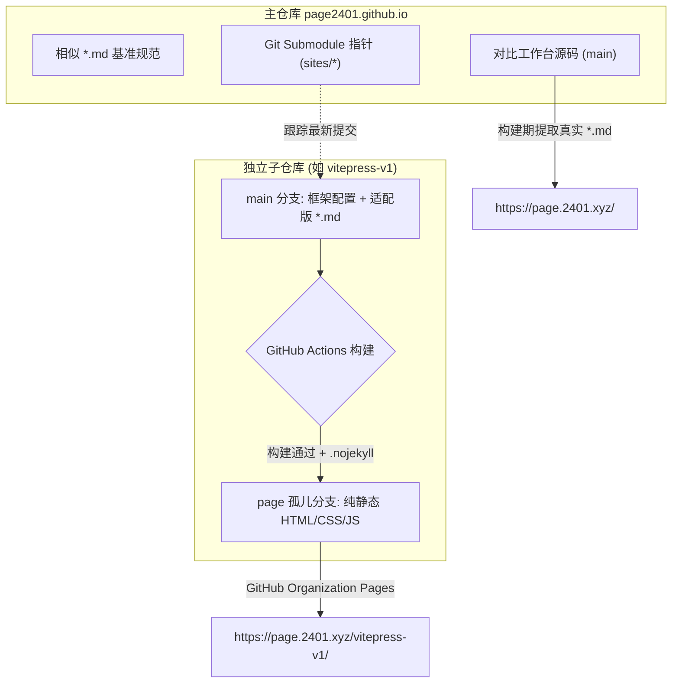
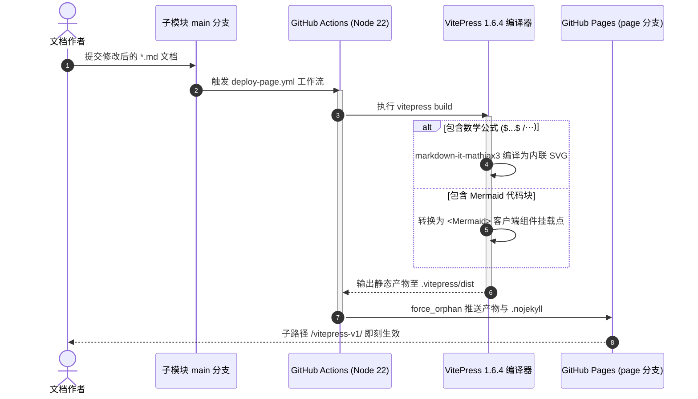
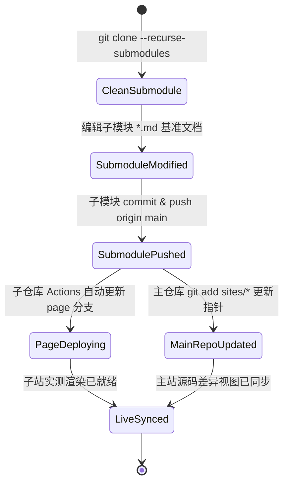

# 02. 流程图与时序图（Mermaid） <Badge type="info" text="mermaid@11.17.2" />

VitePress v1 默认**不会**将 ` ```mermaid ` 代码块渲染为图形，而是当作普通代码高亮显示。本子站通过社区主流方案 `vitepress-plugin-mermaid@2.0.17` 包装 `.vitepress/config.mts` 完成接入。

::: warning 插件版本约束实录
实测发现 `vitepress-plugin-mermaid@2.0.17` 的 `peerDependencies` 声明为 `"mermaid": "10 || 11"`，尚不兼容最新的 `mermaid@12.x`，因此本子站精确锁定 `mermaid@11.17.2`。
:::

## 1. 复杂子图与架构流程图（`flowchart TD`）

测试中文节点标签、子图嵌套（`subgraph`）、虚线边与条件分支：



## 2. 编译管线交互时序图（`sequenceDiagram`）

测试多参与者生命线、`alt` 分支块及激活框（`activate`/`deactivate`）：



## 3. 子模块同步状态机（`stateDiagram-v2`）

测试状态机语法与状态迁移说明标签：


