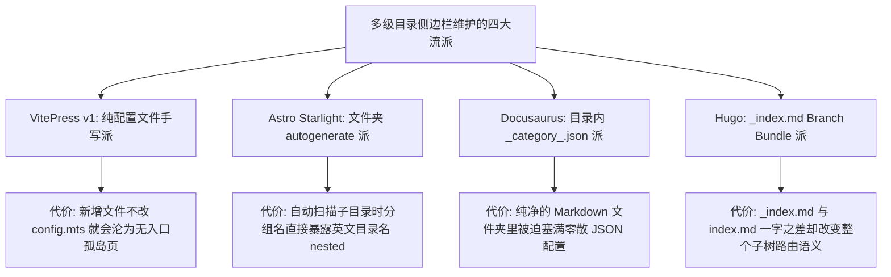

# 04. 目录结构与路由取舍 <Badge type="warning" text="没有银弹" />

静态网站生成器的目录组织看似简单，实则受制于一组**不可能三角**：**本地编辑器/GitHub 浏览友好度**、**生成 URL 的纯净度**、以及**多级侧边栏的零配置自动化**，没有任何一个现有方案能同时完美兼顾三者。

## 1. 痛点一：文档根目录隔离 vs 目录层级深度

在 **VitePress v1** 中，官方默认推荐直接以项目根目录（或单层 `docs/`）作为内容根：

- **优势**：目录层级极浅，把一个现有的 Markdown 文件夹变成网站几乎零迁移成本。
- **真实痛点**：内容文件（`index.md`、`01-annotations.md`）与工程文件（`package.json`、`README.md`）混处同一目录。**如果不显式配置 `srcExclude: ['README.md']`，仓库本身的 `README.md` 会被 VitePress 当成网页编译为 `/README.html`**（甚至若缺少 `index.md` 会直接篡夺网站首页）。

::: warning 对比 Astro Starlight 的另一极端
Astro 7 + Starlight 强制要求文档深埋在 `src/content/docs/`（前置 3 层目录）并配合 `src/content.config.ts`。虽然彻底根除了误编译 `README.md` 的隐患，但目录层级过深，对想直接挂载纯笔记库（如 Obsidian Vault）的用户侵入性很强。
:::

## 2. 痛点二：本地排序前缀（`01-`）与干净 URL 的两难

当一个目录下有多篇有先后阅读顺序的文档时：

| 排序策略 | 在 IDE / GitHub 文件列表中的顺序 | 生成的线上 URL | 核心代价 |
| :--- | :--- | :--- | :--- |
| **文件名加数字前缀** （本子站做法：`01-prefix-order.md`） | 按 `01`、`02` 整齐排列，一目了然 | `/04-directory/nested/01-prefix-order`（**URL 被序号污染**，中间插入新文章改序号会导致旧链接全部 404） | 若想抹除 URL 中的 `01-`，必须在 `.vitepress/config.mts` 额外维护 `rewrites` 映射规则 |
| **纯语义文件名 + Frontmatter `order`** （Starlight 子站做法：`zeta-first.md`） | 按字母 `alpha` -> `zeta` 排列（**与实际阅读顺序颠倒**，文章超 20 篇后本地极难找） | `/04-directory/nested/zeta-first`（URL 纯净稳定，调整顺序不破链接） | 必须在打开每个文件看 Frontmatter 后才知道谁排第一 |

## 3. 痛点三：多级嵌套子目录与侧边栏四大流派对比

本章节专门建立了嵌套子目录 `04-directory/nested/` 以实测多级路由（可直接点击左侧边栏或下方链接进入子页面验证）：

- [进入嵌套子页 1：`04-directory/nested/01-prefix-order`](./nested/01-prefix-order)
- [进入嵌套子页 2：`04-directory/nested/02-manual-sidebar`](./nested/02-manual-sidebar)

